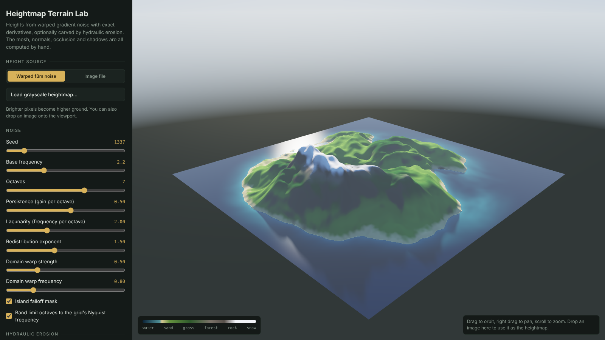
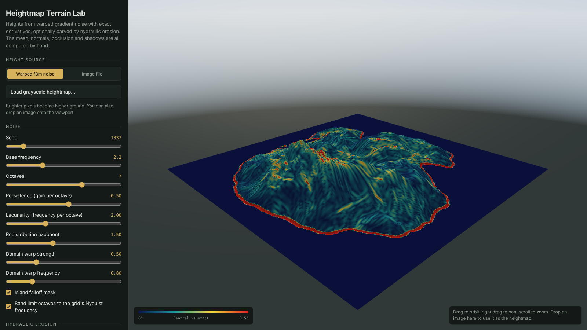
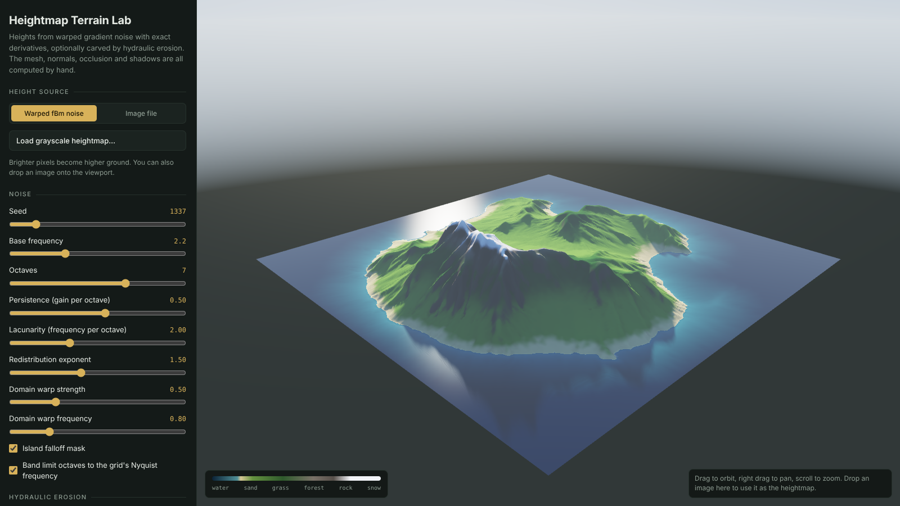

# Heightmap Terrain Lab

A procedural terrain generator in WebGL. It turns a 2D height field into a lit, shaded 3D mesh, and every piece of the math is written by hand: the noise and its exact derivatives, the vertex, UV and index buffers, four ways of computing normals, hydraulic erosion, ambient occlusion and a custom GLSL shader. Three.js is used only for the renderer, camera and orbit controls.



## Run it

Open `index.html` in Chrome, Firefox or Safari. There is no build step and nothing to install.

To check the math, run the test suite with Node 16 or newer:

```bash
npm test
```

## Features

**Height field**
* Gradient noise that returns its exact analytic derivative alongside its value
* fBm with each octave rotated, so octave lattices never line up
* Domain warping, differentiated through its Jacobian
* Octaves band limited to the grid's Nyquist frequency, which prevents aliasing
* Grayscale image heightmaps, loaded with the file picker or by drag and drop

**Mesh**
* Positions, UVs and a 32 bit index buffer built in plain JavaScript
* Each cell split along its shorter 3D diagonal, so triangles follow ridges and valleys
* Normals computed four ways: analytic, central difference, Sobel 3×3 and area weighted faces

**Erosion**
* Particle hydraulic erosion that runs live in the viewport
* Droplet speed follows energy conservation
* Parameters give the same result at any grid resolution

**Shading**
* Custom GLSL shader blending a height and slope material ramp
* Horizon based ambient occlusion
* Soft shadows raymarched against the height field
* Schlick Fresnel water and aerial perspective
* Linear lighting with ACES tonemapping

**Debug views**
* Shaded, normals, normal error heatmap, slope, AO and light only

## Measuring the normals

Because the height function has an exact gradient, every numeric normal method can be scored against the true surface normal. The app shows this as a live table and as a heatmap.



The test suite runs the same comparison on a known analytic surface:

| Grid | Central | Sobel | Face weighted |
|---|---|---|---|
| 33 | 0.518° | 1.011° | 2.121° |
| 65 | 0.148° | 0.270° | 0.751° |
| 129 | 0.045° | 0.073° | 0.264° |
| 257 | 0.016° | 0.020° | 0.093° |

Each time the grid spacing halves, the central difference error drops by about 4 times, which is the expected second order convergence.

Band limiting matters too. Without it, the finest octaves fall below 2 samples per cycle and the mean normal error at 256 × 256 rises from about 0.9° to about 9°.

## Hydraulic erosion



## How it works

[docs/MATH.md](docs/MATH.md) has the full derivations: noise derivatives, the chain rule through fBm and domain warping, triangulation and winding, the normal formulas, erosion, AO and the shading model.

## Project layout

```
index.html               UI and layout
src/noise.js             gradient noise, fBm, domain warp, exact gradients
src/erosion.js           hydraulic erosion
src/mesh.js              vertices, UVs, triangulation, normals, AO, error metrics
src/shaders.js           terrain and sky GLSL
src/main.js              scene setup, build pipeline, controls
tests/math.test.js       derivative, topology, convergence and erosion tests
docs/MATH.md             derivations
docs/images/             screenshots
```

## License

MIT
